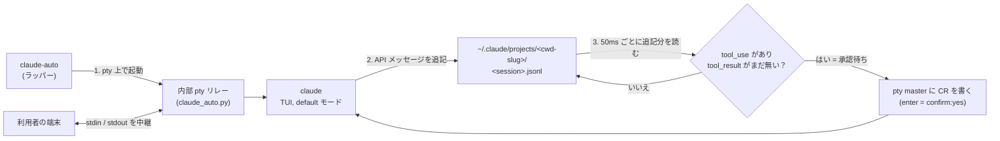

# claude-auto

[](./LICENSE)
[](https://www.python.org/)

[English](./README.md) | **Japanese**

**Claude Code の「このコマンドを実行してもいいですか？」という確認を、自動で「はい」と答えてくれるコマンドです。**
標準の `auto` モードや `--dangerously-skip-permissions` が使えないサンドボックス環境向けに作られています。

> [!WARNING]
> **`claude-auto` は、シェルコマンドの実行やファイルの書き換えを含むすべての確認を、内容を見ずに承認します。**
> 壊れても困らない環境（Docker コンテナ、VM、使い捨ての作業用コピーなど）でだけ使ってください。
> 本番環境の認証情報、SSH 鍵、バックアップのない大事なファイルが見えるマシンでは使わないでください。

---

## 目次

1. [これは何？](#これは何)
2. [自分に必要か確認する](#自分に必要か確認する)
3. [インストール](#インストール)
4. [使ってみる](#使ってみる)
5. [うまく動かないとき](#うまく動かないとき)
6. [設定（環境変数）](#設定環境変数)
7. [アンインストール](#アンインストール)
8. [詳しく知りたい人向け](#詳しく知りたい人向け)

---

## これは何？

[Claude Code](https://code.claude.com/) は、コマンドを実行したりファイルを編集したりする前に、毎回次のような確認を出します。

```
Do you want to proceed?
❯ 1. Yes
  2. No
```

安全のための仕組みですが、隔離されたサンドボックスで作業を任せたいときは、確認のたびに作業が止まってしまいます。

一般的には Claude Code 標準の **`auto` モード**や **`--dangerously-skip-permissions`** を使えば確認を省略できます。しかし企業やクラウドの管理された環境では、次のように**標準の自動化手段がすべて使えない**ことがあります。

* **`auto` モードが使えない** — 組織のポリシー（`disableAutoMode`）で無効化されている、プランやプロバイダが対応していない、など。
* **`--dangerously-skip-permissions`（`bypassPermissions`）が使えない** — コンテナ内で `root` として動いているために拒否される、または管理者設定（`permissions.disableBypassPermissionsMode: "disable"`）で黙って `default` モードに戻される。
* **`--permission-mode acceptEdits` が無視される** — 環境変数の整理（`CLAUDE_CODE_SUBPROCESS_ENV_SCRUB`）やポリシーで `default` モードに戻される。
* **フックや `allow` ルールも使えない** — `allowManagedHooksOnly` / `disableAllHooks` でフックが禁止され、`allow` ルールのワイルドカード `"*"` も拒否される。

**`claude-auto` は、こうした環境でも Claude Code の「外側」から確認に答えることで、自動承認を実現します。**
確認が出ると、約 **15 ミリ秒**で `Enter`（=「Yes」）を押します。人の目にはほとんど確認画面が見えない速さです。

特徴:

* **Claude Code 本体を改造しません**（アップデートしても壊れにくい）
* **今までの `claude` コマンドや `.bashrc` は変更しません**（`claude-auto` という別のコマンドが増えるだけ）
* **画面の文字を読み取りません**（Claude Code が書き出す記録ファイルを読むので、画面サイズや表示言語の影響を受けません）
* **追加のインストールは不要**（`python3` の標準機能だけで動きます）

---

## 自分に必要か確認する

もっと簡単な方法が使えるなら、そちらを使ってください。上から順に試すのがおすすめです。

| 環境・状況 | おすすめの方法 |
|---|---|
| 標準の `auto` モードが使える | `claude --permission-mode auto` |
| コンテナが `root` だという理由だけで `--dangerously-skip-permissions` が拒否される | `IS_SANDBOX=1 claude --dangerously-skip-permissions`（または `~/.claude/settings.json` に `{"env":{"IS_SANDBOX":"1"}}` を追加） |
| `bypassPermissions` は禁止されているが、フックは使える | `PreToolUse` フックで `permissionDecision: "allow"` を返す |
| **上のどれも使えず、`default` モードに戻されてしまう** | **`claude-auto` を使う** |

---

## インストール

### 手順 1. 必要なものがそろっているか確認する

ターミナル（コマンドを入力する画面）で次のコマンドを実行してください。

```bash
claude --version     # Claude Code（2.1.x）がインストールされているか
python3 --version    # Python 3.10 以上が入っているか
```

どちらもバージョン番号が表示されれば OK です。
`command not found` と表示された場合は、先にそのソフトをインストールしてください。

対応 OS: **Linux / macOS / WSL**（Windows では WSL の中で使ってください）

### 手順 2. インストールする

次の 1 行をコピーして、ターミナルに貼り付けて実行します。

```bash
curl -fsSL https://raw.githubusercontent.com/yukkes/claude-auto/main/setup.sh | bash
```

最後に `installed: ...` と表示されれば成功です。
次のものが作られます。

* `~/.local/bin/claude-auto` — 実際に打つコマンド（`claude` と同じフォルダに置かれます）
* `~/.local/share/claude-auto/claude_auto.py` — 自動承認を行う本体

元の `claude` コマンドや `~/.bashrc` は変更されません。

> [!TIP]
> `warning: ... is not on your PATH` と表示された場合は、そのフォルダがコマンドの検索対象に入っていません。
> `--bin-dir` で別の場所を指定してインストールし直してください（[アンインストール](#アンインストール)の下の例を参照）。

### 手順 3. インストールできたか確認する

```bash
command -v claude-auto
```

`/home/<ユーザー名>/.local/bin/claude-auto` のようにパスが表示されれば完了です。

---

## 使ってみる

いつもの `claude` を `claude-auto` に置き換えるだけです。オプションもそのまま使えます。

```bash
# 自動承認つきで Claude Code を起動
claude-auto

# モデルと最初の指示を指定して起動
claude-auto --model haiku "src/ をリファクタリングしてテストを通してください"

# 前回の会話の続きから再開
claude-auto --continue
```

確認を自分で見ながら慎重に作業したいときは、今まで通り `claude` を使ってください。

### 動いているか確かめる

起動すると、最初に次のような 1 行が表示されます。

```
claude-auto: log -> /tmp/claude-auto-12345.log  (pass through: CC_NO_WRAP=1 claude-auto ...)
```

別のターミナルでこのログを開くと、承認の様子が見られます。

```bash
tail -f /tmp/claude-auto-12345.log
```

```
[2026-11-18 21:14:29.512] [autoapprove] transcript: ~/.claude/projects/-home-user-work/e2314e7d-....jsonl
[2026-11-18 21:14:29.513] [autoapprove] permissionMode = default
[2026-11-18 21:14:30.784] [autoapprove] tool_use Bash (hvV6qE) {"command": "mkdir -p /tmp/ccdt && ..."}
[2026-11-18 21:14:30.805] [autoapprove] enter#1 -> Bash
[2026-11-18 21:14:31.096] [autoapprove] tool_result Bash (hvV6qE) — 301ms after enter, 312ms after detection
```

* `tool_use` … Claude がコマンドなどを使おうとした
* `enter#1` … `claude-auto` が「Yes」を押した
* `tool_result` … コマンドの実行が終わった

### スクリプトや CI から使う（ヘッドレスモード）

キーボードがつながっていない状態（パイプやスクリプトから実行したとき）でも使えます。
この場合は、Claude の作業がひと区切りついたら自動で終了します。ログは標準エラー出力に出ます。

```bash
claude-auto "README の誤字を直して" < /dev/null
```

> [!IMPORTANT]
> ヘッドレスモードでは「このフォルダを信頼しますか？」という最初の確認に答えられません。
> 初めて使うフォルダでは、先に一度ふつうに `claude` を起動して「Yes」を選んでおいてください。
> 詳しくは[うまく動かないとき](#うまく動かないとき)を参照してください。

### 自動承認しないコマンド

次の場合は自動承認を行わず、ふつうの `claude` をそのまま実行します。

* `-p`, `--print`, `--version`, `-v`, `--help`, `-h` を最初の引数に付けたとき
* `help`, `update`, `doctor`, `config`, `mcp`, `install`, `setup-token` のサブコマンド
* 環境変数 `CC_NO_WRAP=1` を付けたとき（例: `CC_NO_WRAP=1 claude-auto`）

### 気をつけること

* **文字を入力している途中は承認しません。** 入力欄に送信前の文章があるときに `Enter` を送ると、その文章が送信されてしまうためです。文章を送信するか消す（Ctrl-U）と、自動承認が再開します。
* **Claude からの選択肢つきの質問（AskUserQuestion）には答えません。** ご自身で選んでください。ただしヘッドレスモードでは答える人がいないので、1 番目の選択肢が自動で選ばれます。
* **`--continue` や、ID を指定しない `--resume` で再開するときは、同じフォルダで別の Claude Code を同時に動かさないでください。** どの記録ファイルが再開されたかを `claude-auto` が判断できず、別のセッションの記録と取り違えることがあります（新しく始めるときや `--resume <セッションID>` のときは問題ありません）。
* **サブエージェント（Task / Agent ツール）が出す確認は承認されません。** サブエージェントの記録は別のファイルに書かれるためです。

---

## うまく動かないとき

**`claude-auto: <フォルダ> has no persisted workspace trust`（終了コード 2）と表示される**

ヘッドレスモードで、まだ信頼していないフォルダを開こうとしています。次のどれかで解決できます。

* そのフォルダで一度 `claude` を起動し、信頼の確認で「Yes」を選ぶ
* `~/.claude.json`（`CLAUDE_CONFIG_DIR` を設定している場合は `$CLAUDE_CONFIG_DIR/.claude.json`）の `projects["<フォルダ>"].hasTrustDialogAccepted` を `true` にする
* `CC_TRUST_ANYWAY=1` を付けてチェックを飛ばす（ただし、その場合は確認画面で止まったままになります）

信頼済みのフォルダの中にあるサブフォルダは、信頼済みとして扱われます。
ただし git リポジトリの中では、リポジトリの一番上のフォルダより上はさかのぼりません。
ホームフォルダの信頼は保存されないので、ホームフォルダ直下での実行は避けてください。

**ログに `enter#1` が出ないのにコマンドが実行される**

ログの `permissionMode = ...` を確認してください。`auto` になっている場合は、Claude Code 自身が自動で許可しているので、確認画面がそもそも出ていません。
`CC_MODE=default claude-auto ...` で起動すると、`claude-auto` による承認の動きを確かめられます。

**ログに `transcript:` の行が出てこない**

Claude Code の記録ファイルが見つかっていません。
記録は `~/.claude/projects/<フォルダ名>/` に作られます。`<フォルダ名>` は、作業フォルダのパスの英数字以外をすべて `-` に置き換えたものです（例: `/home/u/my_app.v2` → `-home-u-my-app-v2`）。
そのフォルダに `.jsonl` ファイルが作られているか確認してください。
上の「気をつけること」に当てはまっていないかも確認してください。

**危険なコマンドで確認画面が消えない**

危険度の高い操作では、確認画面の初期選択が「No」になっています。
`claude-auto` は約 3 秒後（20 回目）から、`↑` で「Yes」に移動してから `Enter` を押すように切り替えます。もっと早くしたい場合は `claude_auto.py` の `UP_AFTER` を小さくしてください。

**ヘッドレスモードがいつまでも終わらない**

Claude の作業がひと区切りつき、実行中のコマンドがなくなったときに終了します。長いコマンドを実行している間は待ち続けます。必要なら `timeout` コマンドや Ctrl-C で止めてください。

**強制終了したあと、ターミナルの表示がおかしい**

`stty sane` と入力して Enter を押すと元に戻ります。

**バックグラウンドに回したい（detach したい）**

`claude-auto` 自身は対応していません。`tmux` などの中で起動してください。

---

## 設定（環境変数）

ふだんは何も設定しなくても使えます。必要なときだけ、コマンドの前に `変数名=値` を付けて指定します（例: `CC_DEBUG=1 claude-auto`）。

| 変数名 | 既定値 | 説明 |
|---|---|---|
| `CC_NO_WRAP` | `0` | `1` にすると自動承認せず、ふつうの `claude` を実行 |
| `CC_MODE` | *（空）* | `--permission-mode` を指定したいときだけ使う（例: `default`, `acceptEdits`） |
| `CC_LOG_FILE` | ターミナルあり: `/tmp/claude-auto-<pid>.log`、なし: 標準エラー出力 | ログの出力先 |
| `CC_DEBUG` | `0` | `1` にすると再送（`enter#2` 以降）のログも出力 |
| `CC_EXIT_ON_IDLE` | ターミナルなし: 有効、あり: 無効 | 作業がひと区切りついたら自動で終了するか |
| `CC_IDLE_GRACE` | `1.0` | 作業が終わってから終了するまでの待ち時間（秒） |
| `CC_TRUST_ANYWAY` | `0` | ヘッドレスモードで、信頼していないフォルダでも実行する |
| `CC_POLL` | `0.05` | 記録ファイルを確認する間隔（秒）。[CPU 使用率との関係](#既定の確認間隔が-50ms-の理由)を参照 |
| `CC_COLS` / `CC_ROWS` | `200` / `50` | ターミナルがないときの画面サイズ |
| `CLAUDE_REAL` / `CLAUDE_BIN` | インストール時に決定 | 実際に起動する `claude` 本体のパス |
| `CLAUDE_AUTO_DRIVER` | インストール時に決定 | インストールした `claude_auto.py` の場所 |
| `CLAUDE_CONFIG_DIR` | `~/.claude` | Claude Code と同じ設定。記録ファイルを `$CLAUDE_CONFIG_DIR/projects` から探す |
| `CLAUDE_CODE_PROJECT_DIR_NAME` | *（空）* | Claude Code と同じ設定。記録フォルダの名前を指定する（`CLAUDE_CONFIG_DIR` を設定しているときだけ有効） |

`CC_SESSION` と `CC_ATTACH` は、tmux を使っていた旧バージョンの設定です。現在は無視されます。

---

## アンインストール

```bash
curl -fsSL https://raw.githubusercontent.com/yukkes/claude-auto/main/setup.sh | bash -s -- --uninstall
```

インストールで作られたコマンドと本体が削除されます。`claude` 本体には影響しません。

その他のインストール方法:

```bash
# インストール先のフォルダを指定する
curl -fsSL https://raw.githubusercontent.com/yukkes/claude-auto/main/setup.sh | bash -s -- --bin-dir /usr/local/bin

# リポジトリをダウンロードしてインストールする
git clone https://github.com/yukkes/claude-auto.git
cd claude-auto
./setup.sh
```

---

## 詳しく知りたい人向け

### 仕組み

どんなに厳しく `default` モードに固定された環境でも、Claude Code は確認画面を出して人間の答えを待ちます。`claude-auto` は、その「人間が Enter を押す」部分だけを代わりに行います。

用語:

* **PTY（疑似端末）** … プログラムから見ると本物のターミナルに見える仮想の画面。`claude-auto` はこれを自分で用意して、その上で `claude` を動かします。
* **トランスクリプト** … Claude Code が会話の内容を記録する `.jsonl` ファイル（`~/.claude/projects/<フォルダ名>/<セッションID>.jsonl`）。
* **`tool_use` / `tool_result`** … トランスクリプトに書かれる「ツールを使います」「ツールの結果です」という記録。



1. **起動前の記録**: `claude` を起動する前に、記録フォルダにある `.jsonl` ファイルとそのサイズを覚えておきます。こうすることで、過去の会話を新しい確認と取り違えません（`--continue` で再開したときも、追記された部分だけを読みます）。
2. **自前の PTY**: `pty.fork()` で PTY を用意し、その上で `claude` を起動します。`tmux` や `script` は不要です。キー入力と画面出力はそのまま中継し、終了時には必ずターミナルの設定を元に戻します。
3. **トランスクリプトの監視**: 50ms ごと（`CC_POLL`。画面出力があったときにも）に、`.jsonl` ファイルに追記された行を読みます。
   * Claude がツール（`Bash`, `Write`, `Edit`, `WebFetch`, MCP ツールなど）を使おうとすると、`tool_use` が書かれます。
   * ツールの実行が終わると、対応する `tool_result` が書かれます。
4. **承認待ちの判定と `Enter`**:
   * **「`tool_use` があるのに、対応する `tool_result` がまだない」＝「確認画面で止まっている」** と判断します。
   * すぐに PTY へ `Enter`（`\r`）を送ります。
   * ただし、トランスクリプトだけでは「確認画面が出ている」のか「自動で許可されたツールが実行中」なのかを区別できません。そこで送り直しは、画面の出力が少ないとき（直近 1 秒の書き込みが 3 回以下）だけ、150ms ごとに最大 40 回まで行います。ツールの実行中はスピナーが 1 秒に約 10 回描き直されますが、確認画面で待っている間はほとんど描き直されません。
   * 危険度の高い操作（`default_to_no`）では初期選択が「No」なので、20 回目からは `↑` を送ってから `Enter` を押します。

新しく始めるセッションには、`claude-auto` が `--session-id <uuid>` を付けて起動します。そのため、同じフォルダで別の Claude Code が動いていても、自分の記録ファイルを取り違えません。
Claude Code の中から起動された場合は、記録ファイルが保存されるように `CLAUDE_CODE_FORCE_SESSION_PERSISTENCE=1` を付けて `claude` を起動します。

記録フォルダ名は Claude Code と同じ規則で求めています。パスの英数字以外をすべて `-` に置き換え、200 文字を超える場合は先頭 200 文字にハッシュ値を付けます。

### パフォーマンス実測値

Ubuntu 26.04 LTS x86_64、Claude Code `v2.1.327`（`--model haiku`、`--permission-mode default`、1 回につき確認 1 つ）で **10 回測った中央値**です。

| 指標 | 中央値 | 最小 – 最大 |
|---|---|---|
| **トランスクリプト書き込み → 検出** | **15.1 ms** | 8.7 – 38.3 ms |
| **検出 → PTY へ `Enter` 書き込み** | **0.22 ms** | 0.14 – 0.29 ms |
| **トランスクリプト書き込み → `Enter` 書き込み完了** | **15.3 ms** | 8.9 – 38.5 ms |
| **`Enter` → `tool_result` 記録**（ツールの実行時間を含む） | **200 ms** | 180 – 251 ms |
| **1 回目の `Enter` で承認できた割合** | **10 / 10 回** | — |

遅延のほとんどはトランスクリプトの確認間隔によるもので、キーを送る処理自体は約 0.06ms です。`tool_use` が記録された時点で確認画面はすでに入力を受け付けているので、1 回目の `Enter` でそのまま承認されます。
画面出力があるとすぐに確認するので、検出が `CC_POLL` より速くなることもあります。

### 既定の確認間隔が 50ms の理由

WSL2 では、タイマーで 1 回起きるたびに約 50µs の CPU を使います。そのため、確認間隔を短くするほど CPU 使用率が上がります。何もしていないセッション（16 vCPU、claude 本体は 4.4%）での実測値です。

| `CC_POLL` | ドライバーの CPU | 検出の中央値 |
|---|---|---|
| `0.005` | **10.0%** | 約 4ms |
| `0.01` | **6.1%** | 約 6ms |
| **`0.05`（既定）** | **1.7%** | **15ms** |
| `0.2` | **0.4%** | 約 90ms |

ツールの実行には約 200ms かかるので、15ms と 4ms の差は体感できません。一方で、長時間動かすと 10% の CPU は無視できません。CPU を節約したいなら `0.2` に近づけ、起床コストの小さいネイティブ Linux なら `0.01` に近づけてください。

### なぜ他の方法を選ばなかったのか

Claude Code `v2.1.327` のネイティブバイナリ（372MB の Bun standalone ELF）を解析し、他の方法も実際に試した結果です。

| 方法 | 結果 | 理由 |
|---|---|---|
| **トランスクリプト JSONL の監視（本ツール）** | **採用** | API の構造化メッセージ（`tool_use` / `tool_result`）を直接読むので、画面サイズ・ANSI エスケープ・折り返し・表示言語の影響を受けない。 |
| **`claude` バイナリの書き換え** | 失敗 | ELF 内に見える JS はスタックトレース用で、実際にはコンパイル済みの JSC バイトコード（`@bytecode` / `BUN_BYTECODE`）が実行される。見える JS を書き換えても動作は変わらない。 |
| **画面文字列の読み取り** | 不採用 | Ink の差分描画でカーソル移動のエスケープが混ざり、狭い画面では `This terminal is too short...` で選択肢が表示されないなど、判定が壊れやすい。 |
| **TLS プロキシ（`ANTHROPIC_BASE_URL`）** | 不採用 | プロキシと SSE の処理が必要な上、managed settings でエンドポイントが固定された環境では起動を拒否される。 |
| **プロセスメモリの読み取り（`/proc/<pid>/mem`）** | 不採用 | `yama/ptrace_scope=1` で非 root からは `EACCES`。root でも JSC ヒープの文字列は断片化・UTF-16 化・GC で移動しており、12 以上の領域が `EIO` になり、安定して読めない。 |
| **`inotify` と `os.stat()` ポーリング** | **`os.stat()` を採用** | コストの正体は stat ではなくタイマー起床（WSL2 で約 50µs）。`inotify` なら検出は約 1ms になるが、Linux 専用で `ctypes` が必要なうえ、macOS 用にポーリングも残す必要がある。200ms のツール実行に比べれば差は見えないので、どこでも動く 1 つの方法を選んだ。 |

### ファイル構成

```
claude-auto/
├── claude_auto.py        # プログラム本体（1ファイル、Python 3 標準ライブラリのみ）
├── test_claude_auto.py   # 単体テスト
├── setup.sh              # claude-auto コマンドのインストーラー／アンインストーラー
├── README.md / README.ja.md
└── LICENSE               # MIT ライセンス
```

### 開発者向け

```bash
python3 -m unittest -v               # リポジトリの一番上でテストを実行
python3 claude_auto.py --version     # チェックアウトから直接実行（claude にそのまま渡されます）
```
---

## ライセンス

MIT © [yukkes](https://github.com/yukkes)。詳しくは [LICENSE](./LICENSE) を参照してください。
