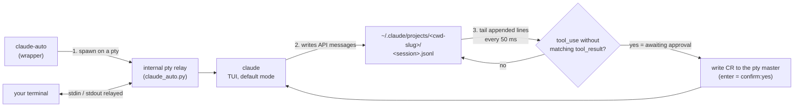

# claude-auto

[](./LICENSE)
[](https://www.python.org/)

**English** | [Japanese](./README.ja.md)

**A command that automatically answers "Yes" to Claude Code's "Do you want to proceed?" prompts.**
It is built for sandboxes where the built-in `auto` mode and `--dangerously-skip-permissions` are unavailable.

> [!WARNING]
> **`claude-auto` approves every prompt — shell commands, file writes, everything — without looking at it.**
> Use it only in environments you can afford to break (a Docker container, a VM, a throwaway copy of your project).
> Never run it on a machine that can see production credentials, SSH keys, or files without a backup.

---

## Contents

1. [What is it?](#what-is-it)
2. [Do you need it?](#do-you-need-it)
3. [Install](#install)
4. [Use it](#use-it)
5. [Troubleshooting](#troubleshooting)
6. [Configuration (environment variables)](#configuration-environment-variables)
7. [Uninstall](#uninstall)
8. [Under the hood](#under-the-hood)

---

## What is it?

Before [Claude Code](https://code.claude.com/) runs a command or edits a file, it asks for permission:

```
Do you want to proceed?
❯ 1. Yes
  2. No
```

That is a good safety net, but inside an isolated sandbox it means the work stops every few seconds until someone presses Enter.

Normally you would turn this off with Claude Code's built-in **`auto` mode** or **`--dangerously-skip-permissions`**. In many corporate, cloud or locked-down environments, however, **none of the built-in options work**:

* **`auto` mode is unavailable** — disabled by organization policy (`disableAutoMode`), or not offered on your plan or provider.
* **`--dangerously-skip-permissions` (`bypassPermissions`) is blocked** — refused because the container runs as `root`, or silently downgraded to `default` by managed settings (`permissions.disableBypassPermissionsMode: "disable"`).
* **`--permission-mode acceptEdits` is ignored** — reset to `default` by environment scrubbing (`CLAUDE_CODE_SUBPROCESS_ENV_SCRUB`) or policy.
* **Hooks and `allow` rules are blocked too** — `allowManagedHooksOnly` / `disableAllHooks` forbid hooks, and the wildcard `"*"` is rejected in `allow` rules.

**`claude-auto` works from the outside: it answers the prompt for you, the way a person would.**
When a prompt appears, it presses `Enter` (= "Yes") in about **15 milliseconds** — usually before you can even see the prompt.

Highlights:

* **Does not modify Claude Code** (keeps working across updates)
* **Does not replace `claude` or touch `.bashrc`** (it only adds a new `claude-auto` command)
* **Does not read the screen** (it reads the log file Claude Code writes, so terminal size and UI language don't matter)
* **Nothing extra to install** (uses only the Python 3 standard library)

---

## Do you need it?

If a simpler option works in your environment, use that instead. Try them from top to bottom:

| Your situation | Recommended option |
|---|---|
| The built-in `auto` mode is allowed | `claude --permission-mode auto` |
| `--dangerously-skip-permissions` is refused only because you are `root` in a container | `IS_SANDBOX=1 claude --dangerously-skip-permissions` (or add `{"env":{"IS_SANDBOX":"1"}}` to `~/.claude/settings.json`) |
| `bypassPermissions` is disabled, but hooks work | A `PreToolUse` hook that returns `permissionDecision: "allow"` |
| **None of the above work and you are forced back to `default` mode** | **Use `claude-auto`** |

---

## Install

### Step 1. Check the requirements

Run these in a terminal:

```bash
claude --version     # Claude Code 2.1.x is installed
python3 --version    # Python 3.10 or later is installed
```

If both print a version number, you are ready.
If you see `command not found`, install the missing program first.

Supported systems: **Linux / macOS / WSL** (on Windows, use it inside WSL).

### Step 2. Install

Copy this line, paste it into your terminal and press Enter:

```bash
curl -fsSL https://raw.githubusercontent.com/yukkes/claude-auto/main/setup.sh | bash
```

It worked if the last lines start with `installed: ...`.
These are created:

* `~/.local/bin/claude-auto` — the command you type (placed next to your `claude`)
* `~/.local/share/claude-auto/claude_auto.py` — the program that does the approving

Your existing `claude` command and `~/.bashrc` are not changed.

> [!TIP]
> If you see `warning: ... is not on your PATH`, your shell will not find the new command in that folder.
> Reinstall into a folder that is on your `PATH` with `--bin-dir` (see the examples under [Uninstall](#uninstall)).

### Step 3. Check the installation

```bash
command -v claude-auto
```

If it prints a path such as `/home/you/.local/bin/claude-auto`, you are done.

---

## Use it

Type `claude-auto` wherever you would type `claude`. All the usual options work.

```bash
# Start Claude Code with automatic approval
claude-auto

# Pick a model and give a first instruction
claude-auto --model haiku "Refactor src/ and make the tests pass"

# Continue your previous conversation
claude-auto --continue
```

When you want to review each step yourself, just use `claude` as before.

### Check that it is working

On start, `claude-auto` prints one line like this:

```
claude-auto: log -> /tmp/claude-auto-12345.log  (pass through: CC_NO_WRAP=1 claude-auto ...)
```

Open that log in a second terminal to watch the approvals:

```bash
tail -f /tmp/claude-auto-12345.log
```

```
[2026-11-18 21:14:29.512] [autoapprove] transcript: ~/.claude/projects/-home-user-work/e2314e7d-....jsonl
[2026-11-18 21:14:29.513] [autoapprove] permissionMode = default
[2026-11-18 21:14:30.784] [autoapprove] tool_use Bash (hvV6qE) {"command": "mkdir -p /tmp/ccdt && ..."}
[2026-11-18 21:14:30.805] [autoapprove] enter#1 -> Bash
[2026-11-18 21:14:31.096] [autoapprove] tool_result Bash (hvV6qE) — 301ms after enter, 312ms after detection
```

* `tool_use` — Claude wants to run a tool (a command, an edit, ...)
* `enter#1` — `claude-auto` pressed "Yes"
* `tool_result` — the tool finished

### From scripts or CI (headless mode)

`claude-auto` also works without a keyboard attached (from a pipe or a script).
In that case it exits by itself once Claude finishes its turn, and logs go to stderr.

```bash
claude-auto "Fix the typos in README" < /dev/null
```

> [!IMPORTANT]
> In headless mode nobody can answer the first-run "Do you trust this folder?" question.
> Before using a new folder, run plain `claude` there once and choose "Yes".
> See [Troubleshooting](#troubleshooting) for details.

### When it does not auto-approve

`claude-auto` simply runs plain `claude` when:

* the first argument is `-p`, `--print`, `--version`, `-v`, `--help` or `-h`
* the subcommand is `help`, `update`, `doctor`, `config`, `mcp`, `install` or `setup-token`
* `CC_NO_WRAP=1` is set (for example `CC_NO_WRAP=1 claude-auto`)

### Things to watch out for

* **Nothing is approved while you have unsent text in the input box.** Pressing `Enter` then would send your draft. Send it or clear it (Ctrl-U) and auto-approval resumes.
* **Multiple-choice questions from Claude (AskUserQuestion) are left to you.** In headless mode nobody can answer, so the first option is picked.
* **When continuing with `--continue` or `--resume` without a session ID, don't run another Claude Code session in the same folder at the same time.** `claude-auto` cannot tell which log was resumed and may pick the other session's (fresh sessions and `--resume <session-id>` are not affected).
* **Prompts raised by subagents (the Task / Agent tool) are not approved**, because subagents write to separate log files.

---

## Troubleshooting

**`claude-auto: <dir> has no persisted workspace trust` (exit code 2)**

You are in headless mode in a folder you have not trusted yet. Any of these fixes it:

* Run `claude` in that folder once and answer "Yes" to the trust question.
* Set `projects["<dir>"].hasTrustDialogAccepted` to `true` in `~/.claude.json` (`$CLAUDE_CONFIG_DIR/.claude.json` if you set `CLAUDE_CONFIG_DIR`).
* Set `CC_TRUST_ANYWAY=1` to skip the check (Claude Code will then wait at the trust question).

Subfolders of a trusted folder count as trusted.
Inside a git repository, though, only folders up to the repository root count.
Trust for your home folder is never saved, so avoid running directly in `~`.

**Tools run, but the log never shows `enter#1`**

Look at `permissionMode = ...` in the log. If it says `auto`, Claude Code is approving tools by itself and no prompt is shown.
Start with `CC_MODE=default claude-auto ...` to see `claude-auto` do the approving.

**The log never shows a `transcript:` line**

`claude-auto` cannot find Claude Code's log.
It lives in `~/.claude/projects/<folder-name>/`, where `<folder-name>` is your working folder's path with every character other than letters and digits replaced by `-` (for example `/home/u/my_app.v2` → `-home-u-my-app-v2`).
Check that a `.jsonl` file appears there.
Also check that none of the [things to watch out for](#things-to-watch-out-for) apply.

**A prompt for a dangerous command stays on screen**

For high-risk actions the prompt starts with "No" selected.
After about 3 seconds (the 20th attempt) `claude-auto` switches to pressing `↑` and then `Enter`. To make that faster, lower `UP_AFTER` in `claude_auto.py`.

**Headless mode never exits**

It exits when Claude finishes its turn and no tool is still running. A long-running command keeps it waiting. Stop it with `timeout` or Ctrl-C if needed.

**The terminal looks broken after a crash**

Type `stty sane` and press Enter.

**I want to run it in the background (detach)**

`claude-auto` cannot detach by itself. Run it inside `tmux` or a similar tool.

---

## Configuration (environment variables)

You don't need to set anything for normal use. When you do, put `NAME=value` in front of the command (for example `CC_DEBUG=1 claude-auto`).

| Variable | Default | Description |
|---|---|---|
| `CC_NO_WRAP` | `0` | `1` runs plain `claude` without auto-approval |
| `CC_MODE` | *(empty)* | Pass a `--permission-mode` (for example `default`, `acceptEdits`) |
| `CC_LOG_FILE` | terminal: `/tmp/claude-auto-<pid>.log`, no terminal: stderr | Where the log goes |
| `CC_DEBUG` | `0` | `1` also logs retries (`enter#2`, ...) |
| `CC_EXIT_ON_IDLE` | on without a terminal, off with one | Exit once Claude finishes its turn |
| `CC_IDLE_GRACE` | `1.0` | Seconds to wait after the turn before exiting |
| `CC_TRUST_ANYWAY` | `0` | Headless only: run even in a folder that is not trusted |
| `CC_POLL` | `0.05` | How often (seconds) to check the log; see [why 50 ms](#why-the-default-poll-is-50-ms) |
| `CC_COLS` / `CC_ROWS` | `200` / `50` | Screen size used when there is no terminal |
| `CLAUDE_REAL` / `CLAUDE_BIN` | set at install time | Path to the real `claude` binary |
| `CLAUDE_AUTO_DRIVER` | set at install time | Path of the installed `claude_auto.py` |
| `CLAUDE_CONFIG_DIR` | `~/.claude` | Same as in Claude Code: logs are looked up under `$CLAUDE_CONFIG_DIR/projects` |
| `CLAUDE_CODE_PROJECT_DIR_NAME` | *(empty)* | Same as in Claude Code: overrides the log folder name (only when `CLAUDE_CONFIG_DIR` is set) |

`CC_SESSION` and `CC_ATTACH` belonged to the old tmux-based version and are ignored.

---

## Uninstall

```bash
curl -fsSL https://raw.githubusercontent.com/yukkes/claude-auto/main/setup.sh | bash -s -- --uninstall
```

This removes the installed command and program. `claude` itself is not affected.

Other ways to install:

```bash
# Install into a specific folder on your PATH
curl -fsSL https://raw.githubusercontent.com/yukkes/claude-auto/main/setup.sh | bash -s -- --bin-dir /usr/local/bin

# Install from a downloaded copy of the repository
git clone https://github.com/yukkes/claude-auto.git
cd claude-auto
./setup.sh
```

---

## Under the hood

### How it works

Even when locked to `default` mode, Claude Code still shows a prompt and waits for a person to answer. `claude-auto` takes over only that "person presses Enter" part.

Terms:

* **PTY (pseudo-terminal)** — a virtual screen that looks like a real terminal to a program. `claude-auto` creates one and runs `claude` on it.
* **Transcript** — the `.jsonl` file where Claude Code records the conversation (`~/.claude/projects/<folder-name>/<session-id>.jsonl`).
* **`tool_use` / `tool_result`** — transcript entries meaning "I am about to use a tool" and "here is the tool's result".



1. **Snapshot before start**: before launching `claude`, record the `.jsonl` files in the log folder and their sizes, so old history is never mistaken for a new prompt (with `--continue`, only newly appended lines are read).
2. **Own PTY**: create a PTY with `pty.fork()` and start `claude` on it — no `tmux` or `script` needed. Keystrokes and screen output are relayed both ways, and the terminal settings are always restored on exit.
3. **Watch the transcript**: every 50 ms (`CC_POLL`, and whenever the screen updates), read the lines appended to the `.jsonl` file.
   * When Claude wants a tool (`Bash`, `Write`, `Edit`, `WebFetch`, MCP tools, ...), a `tool_use` is written.
   * When the tool finishes, the matching `tool_result` is written.
4. **Detect the prompt and press `Enter`**:
   * **"A `tool_use` exists but its `tool_result` has not arrived" = "waiting at the prompt".**
   * `claude-auto` immediately writes `Enter` (`\r`) to the PTY.
   * The transcript alone cannot tell "prompt on screen" from "auto-allowed tool still running", so resends (every 150 ms, up to 40) happen only while the screen is quiet (at most 3 writes in the last second). A running tool repaints its spinner about 10 times a second; a waiting prompt barely repaints.
   * High-risk prompts (`default_to_no`) start with "No" selected, so from the 20th attempt it sends `↑` before `Enter`.

Fresh sessions are started with `--session-id <uuid>`, so `claude-auto` always watches its own log even when other Claude Code sessions run in the same folder.
When started from inside Claude Code, `claude` is launched with `CLAUDE_CODE_FORCE_SESSION_PERSISTENCE=1` so that its log is still saved.

The log folder name follows Claude Code's own rule: every character other than ASCII letters and digits becomes `-`, and names longer than 200 characters are cut to 200 and given a hash suffix.

### Performance

Median of 10 runs on Ubuntu 26.04 LTS x86_64 with Claude Code `v2.1.327` (`--model haiku`, `--permission-mode default`, one prompt per run):

| Metric | Median | Min – Max |
|---|---|---|
| **Transcript write → detected** | **15.1 ms** | 8.7 – 38.3 ms |
| **Detected → `Enter` written to the PTY** | **0.22 ms** | 0.14 – 0.29 ms |
| **Transcript write → `Enter` written** | **15.3 ms** | 8.9 – 38.5 ms |
| **`Enter` → `tool_result` written** (includes running the tool) | **200 ms** | 180 – 251 ms |
| **Approved on the first `Enter`** | **10 / 10 runs** | — |

Almost all of the delay comes from how often the transcript is checked; sending the key itself takes about 0.06 ms. By the time the `tool_use` is written, the prompt already accepts input, so the first `Enter` goes through.
Detection is sometimes faster than `CC_POLL` because screen output also wakes the loop.

### Why the default poll is 50 ms

On WSL2 each timed wakeup costs about 50 µs of CPU, so a shorter interval means more CPU. Measured on an idle session (16 vCPU, Claude Code itself at 4.4%):

| `CC_POLL` | Driver CPU | Median detection |
|---|---|---|
| `0.005` | **10.0%** | ~4 ms |
| `0.01` | **6.1%** | ~6 ms |
| **`0.05` (default)** | **1.7%** | **15 ms** |
| `0.2` | **0.4%** | ~90 ms |

Next to the ~200 ms a tool takes, 15 ms vs 4 ms is not noticeable, but 10% CPU adds up in a long session. Move toward `0.2` to save CPU, or toward `0.01` on native Linux where wakeups are cheaper.

### Why not another approach?

We reverse-engineered the Claude Code `v2.1.327` native binary (a 372 MB Bun standalone ELF) and tried the alternatives:

| Approach | Outcome | Why |
|---|---|---|
| **Watching the transcript JSONL (`claude-auto`)** | **Adopted** | Reads structured API messages (`tool_use` / `tool_result`) directly, so terminal size, ANSI escapes, wrapping and UI language don't matter. |
| **Patching the `claude` binary** | Failed | The readable JS inside the ELF is only for stack traces; what runs is precompiled JSC bytecode (`@bytecode` / `BUN_BYTECODE`), so editing the text changes nothing. |
| **Reading the screen** | Rejected | Ink's diff rendering mixes in cursor-movement escapes, and narrow terminals hide the options (`This terminal is too short...`), so matching is fragile. |
| **TLS proxy (`ANTHROPIC_BASE_URL`)** | Rejected | Needs proxy and SSE plumbing, and is refused when managed settings pin the endpoint. |
| **Reading process memory (`/proc/<pid>/mem`)** | Rejected | `yama/ptrace_scope=1` gives `EACCES` for non-root siblings. Even as root, JSC heap strings are fragmented, UTF-16 and moved by GC, and 12+ regions fail with `EIO`. |
| **`inotify` vs `os.stat()` polling** | **`os.stat()` adopted** | The cost is the timed wakeup (~50 µs on WSL2), not the stat. `inotify` would detect in ~1 ms, but it is Linux-only, needs `ctypes`, and macOS still needs polling. Next to a 200 ms tool call the difference is invisible, so one portable path won. |

### Files

```
claude-auto/
├── claude_auto.py        # the program (one file, Python 3 standard library only)
├── test_claude_auto.py   # unit tests
├── setup.sh              # installer / uninstaller for the claude-auto command
├── README.md / README.ja.md
└── LICENSE               # MIT
```

### Development

```bash
python3 -m unittest -v               # run the tests from the repository root
python3 claude_auto.py --version     # run straight from a checkout (passes through to claude)
```
---

## License

MIT © [yukkes](https://github.com/yukkes). See [LICENSE](./LICENSE).
